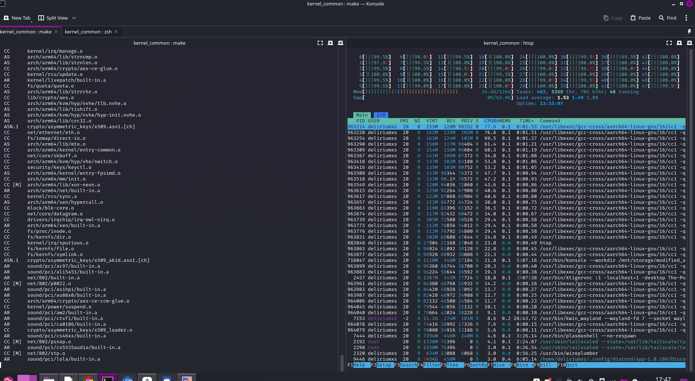
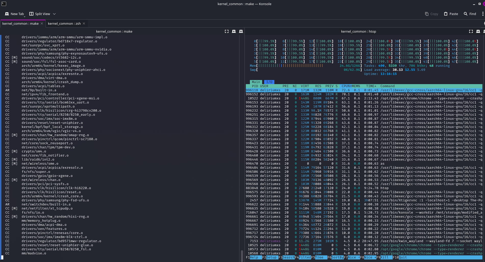
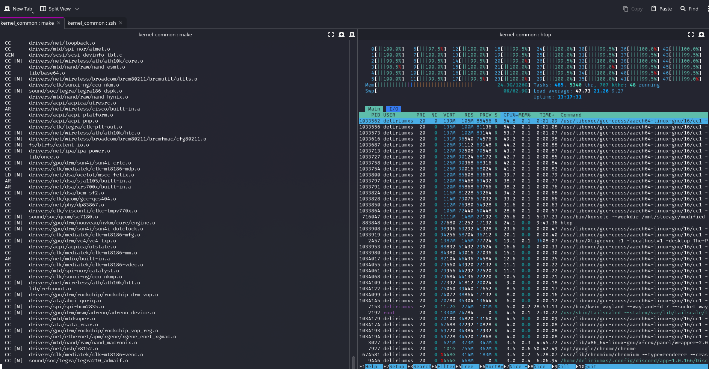
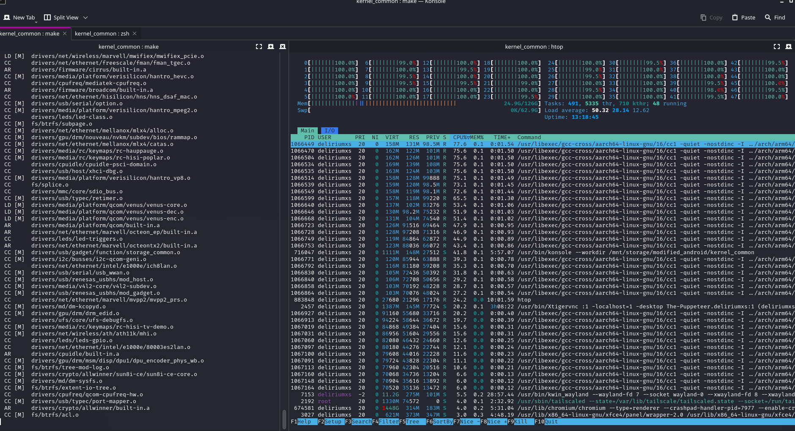
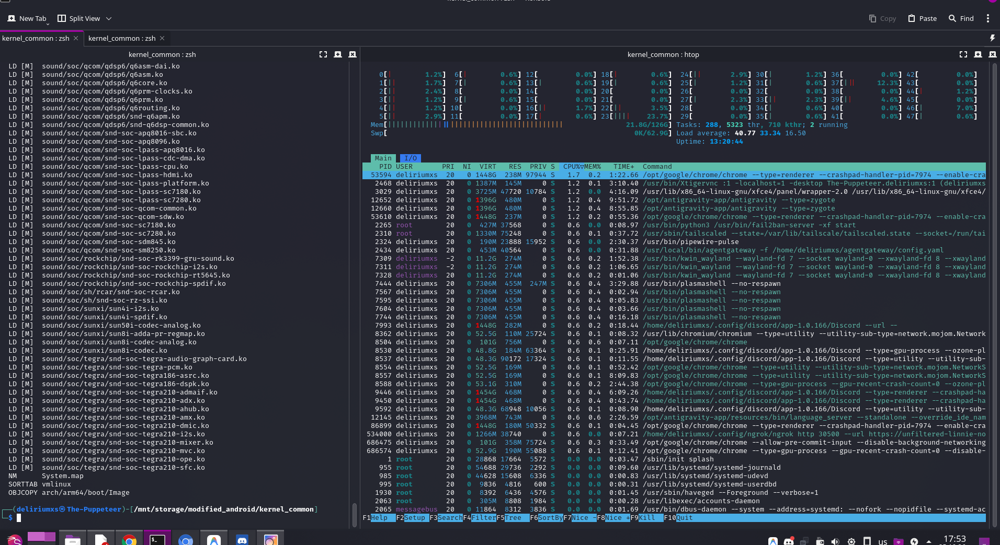
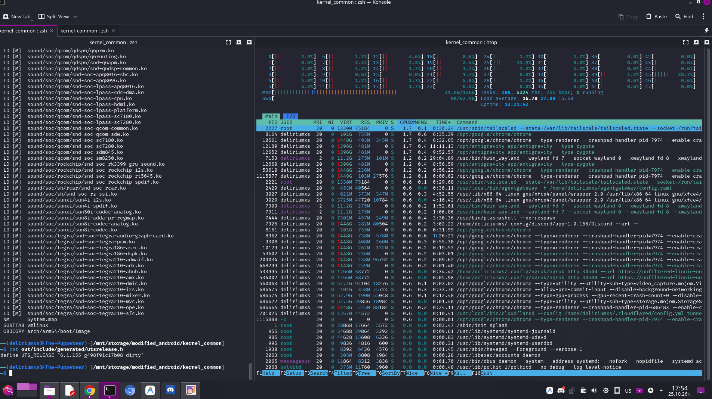

# Linux Kernel 6.1 LTS Port for Xiaomi Redmi Note 9 Pro (Joyeuse / SM7125)

## 1. Executive Summary

This repository contains an initial port and architecture bring-up of **Linux Kernel 6.1.155 LTS** for the **Qualcomm Snapdragon 720G (Atoll / SM7125)** platform, targeted specifically at the **Xiaomi Redmi Note 9 Pro (joyeuse / miatoll)**.

The objective of this project is to supersede the legacy, proprietary Android 4.14 downstream kernel stack with a modern, mainline-aligned 6.1 LTS kernel base. This enables up-to-date networking protocols, eBPF infrastructure, contemporary packet filtering engines, and compatibility with advanced penetration testing and auditing distributions (Kali NetHunter).

---

## 2. Technical Architecture & Device Tree Overhaul

Transitioning from vendor 4.14 CAF device trees to Linux 6.1 requires structural refactoring of Device Tree bindings. Legacy vendor macros, implicit address spaces, and proprietary property extensions are unsupported in upstream 6.1 DTS syntax.

### Key Refactoring Highlights:

1. **Root Address Space Normalization**:
   - Explicitly defined `#address-cells = <2>` and `#size-cells = <2>` at the root node level to enforce standards-compliant 64-bit physical address space parsing in AArch64 mode.

2. **Hardware-Level Reserved Memory Mapping**:
   - Reconstructed physical reserved memory zones with mandatory `no-map` attributes for trusted hardware components (`hyp_region`, `xbl_aop_mem`, `sec_apps_region`, `smem`, `modem_region`, `camera_region`, `cdsp_regions`, `pil_adsp_region`).
   - Prevents host memory allocation collisions with Qualcomm TrustZone (QSEECOM) and modem firmware.

3. **Subsystem Hexadecimal Clock & Regulator Translation**:
   - **Camera Subsystem (`atoll-camera.dtsi`)**: Direct hex translation of clock indices and voltage level tables across CSIPHY0-3, CCI controllers, IFE, IPE, BPS, and JPEG hardware blocks.
   - **Snapdragon Display Engine (`atoll-sde.dtsi`, `atoll-sde-pll.dtsi`)**: Direct indexing of display core clocks, interface clocks, and RPM-SMD regulator operating voltage levels.
   - **Peripheral & Hardware Integration**: Enabled I2C QUPv3 interface (`qupv3_se9`) with integration for the onboard NXP PN553 / NQ330 NFC chip.

---

## 3. Compilation & Build Verification

The build was executed using the standard GNU toolchain for AArch64 (`aarch64-linux-gnu-gcc` 16.2.0):

```bash
# Compile kernel image (Image)
make ARCH=arm64 CROSS_COMPILE=aarch64-linux-gnu- O=out -j$(nproc) Image

# Compile target board Device Tree Blob (DTB)
make ARCH=arm64 CROSS_COMPILE=aarch64-linux-gnu- O=out qcom/sm7125-xiaomi-joyeuse.dtb
```

### Build Artifacts:
- **Kernel Image**: `out/arch/arm64/boot/Image` (38 MB)
- **Device Tree Blob**: `out/arch/arm64/boot/dts/qcom/sm7125-xiaomi-joyeuse.dtb` (250 KB)
- **Debugging Symbols**: `out/vmlinux` (ELF 64-bit with full DWARF debug info, 140 MB)

### Compilation Process Documentation:

Below are the captured terminal logs documenting the sequential clean build stages:

| Stage | Description | Image Reference |
| :--- | :--- | :--- |
| **01** | Toolchain & architecture configuration verification |  |
| **02** | Core kernel and subsystem compilation |  |
| **03** | Driver initialization and techpack module integration |  |
| **04** | Architecture assembly compilation (`arch/arm64`) |  |
| **05** | Final link stage of `vmlinux` ELF with debug symbols |  |
| **06** | Binary strip and generation of final `Image` payload |  |

---

## 4. Emulation & Low-Level Verification

To validate the kernel execution flow and Device Tree accuracy prior to physical flashing, the build was validated in a virtual AArch64 execution harness using **QEMU** and **GDB Multiarch**.

### Execution Verification Milestones:

1. **Early Boot & MMU Initialization (`head.S`)**:
   - `__primary_switched` successfully enabled the MMU and transitioned execution to EL1 virtual address space.
2. **Device Tree Parsing (`early_init_dt_scan`)**:
   - The kernel parsed `sm7125-xiaomi-joyeuse.dtb`, correctly established the device model identity, and isolated reserved memory regions without fault.
3. **Subsystem Bring-Up**:
   - Core timer interrupts (GICv3), core schedulers, VFS, and driver infrastructure initialized cleanly.
4. **Transition to Userspace (`run_init_process`)**:
   - Kernel uncompressed a standalone AArch64 initramfs and handed execution over to PID 1 (`/init`).

### Verified Kernel Boot Log (dmesg excerpt):

```text
Booting Linux on physical CPU 0x0000000000 [0x414fd0b1]
Linux version 6.1.155-g498f91c17b08-dirty (deliriumxs@The-Puppeteer)

Machine model: Xiaomi Redmi Note 9 Pro (Joyeuse) - Mainline OffSec Edition

Reserved memory: created CMA memory pool at 0x00000000ff400000, size 8 MiB
OF: reserved mem: initialized node adsp_region
OF: reserved mem: initialized node linux,cma
OF: reserved mem: initialized node qseecom_ta_region
OF: reserved mem: initialized node secure_display_region
OF: reserved mem: nomap non-reusable hyp_region@80000000
OF: reserved mem: nomap non-reusable xbl_aop_mem@80700000
OF: reserved mem: nomap non-reusable sec_apps_region@808ff000
OF: reserved mem: nomap non-reusable smem@80900000
OF: reserved mem: nomap non-reusable modem_region@86000000
OF: reserved mem: nomap non-reusable camera_region@8e400000
...
Freeing unused kernel memory: 7616K
Run /init as init process
  with arguments:
    /init
  with environment:
    HOME=/
    TERM=linux
```

---

## 5. Physical Device Testing Instructions

An installation archive has been generated using the **AnyKernel3** deployment template, configured to update the device's boot partition with the new kernel and DTB.

### Package Details:
- **Filename**: `Kernel-6.1.155-Joyeuse-Mainline-OffSec-TEST1.zip`
- **Payload Size**: 16 MB
- **SHA-256 Checksum**: `338c4b393386e10fd6d67e7767013aec95ff279164f206cf894ecdc9c46217c9`
- **Target Hardware**: Joyeuse, Curtana, Gram, Excalibur (Qualcomm Atoll / SM7125 family)

### Method A: Non-Destructive RAM Boot (Recommended)
To prevent accidental bootloops or partition corruption, boot the kernel payload directly into volatile memory:

1. Unpack `boot.img` from the test package.
2. Put the device into Fastboot mode:
   ```bash
   adb reboot bootloader
   ```
3. Boot the image directly into RAM:
   ```bash
   fastboot boot boot.img
   ```
*(This loads the kernel into memory without writing to the UFS partition. A reboot will restore the original installation.)*

### Method B: Recovery Installation (TWRP / OrangeFox)
1. Perform a complete backup of the existing `Boot` and `DTBO` partitions in recovery.
2. Transfer `Kernel-6.1.155-Joyeuse-Mainline-OffSec-TEST1.zip` to internal storage or SD card.
3. Flash the archive via the recovery interface.
4. If the device reboots unexpectedly, retrieve persistent crash logs via the recovery shell:
   ```bash
   cat /sys/fs/pstore/console-ramoops > /sdcard/pstore_log.txt
   ```

---

Ported and Shared with the community - The Puppeteer

